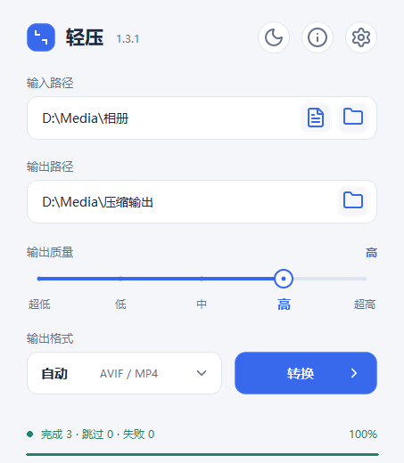

# Lightpress

English | [简体中文](README.zh-CN.md)

Lightpress is a lightweight image and video compressor for Windows. Convert files or entire folders, choose an output format and quality, and keep your originals. All processing takes place on your computer.



[Dark mode](docs/screenshots/dark.png) · [Usage guide (Chinese)](docs/usage.md) · [Development guide (Chinese)](docs/development.md)

## Features

- Batch image and video conversion, with optional subfolder processing and file filters.
- Five quality levels across JPEG, WebP, AVIF, PNG, H.264, H.265 and AV1.
- CPU video encoding and optional NVIDIA hardware encoding.
- Progress reporting, cancellation and per-file results.
- Chinese and English, with automatic language detection and manual switching.
- Light and dark themes, with settings stored alongside the application.

## Getting started

Download `Lightpress-1.0.0-Windows-x64.zip` from Releases, extract it, and run `Lightpress.exe`. Keep the `bin` and `_internal` folders beside the executable. The portable package includes Python, FFmpeg and ffprobe; no separate runtime installation is required.

1. Select files or a folder using the icons beside the input field.
2. Choose an output folder, format and quality level.
3. Click **Convert**. Click the status line to view individual results.

**Auto** mode converts images to AVIF and videos to H.264 MP4. Selecting a specific format processes only the matching media type. Settings provide file filters, metadata options, video encoders and frame-rate controls.

## Supported formats

| Media | Input | Output |
| --- | --- | --- |
| Images | JPEG, PNG, WebP, AVIF, TIFF, BMP | JPEG, WebP, AVIF, PNG |
| Videos | MP4, MOV, MKV, M4V, AVI, WebM, MTS, TS | MP4 (H.264/H.265/AV1 + AAC), WebM (AV1 + Opus) |

CPU encoding works without a dedicated graphics card. NVIDIA encoding requires compatible hardware and drivers. HEIC/HEIF input can be enabled with `pillow-heif` when running from source; the portable package does not include this plugin.

## Portable settings

Settings and processing records are stored in the application's `data/` folder. Extract Lightpress to a writable location and keep `data/` when upgrading. Configuration files are not created in media output folders.

## Running from source

Requires Python 3.11 or later. Install the dependencies, then launch the application:

```powershell
python -m venv .venv
.venv\Scripts\python -m pip install -r requirements.txt
.venv\Scripts\python -m compressor
```

After installing the dependencies, `start.bat` also launches the application. Video processing requires FFmpeg and ffprobe in the project's `bin/` folder or on PATH, with `libx264`, `libx265`, `libsvtav1`, `aac` and `libopus` encoders. See the [development guide](docs/development.md) for tests and packaging.

## Media handling

- JPEG, WebP, AVIF and video conversion use lossy encoding. Keeping the original dimensions does not make conversion lossless.
- PNG's first four quality levels reduce the color palette; the highest level preserves the original colors. JPEG fills transparent areas with white.
- Image output is 8-bit. Animated and multipage images are not supported; multi-image JPEGs require an option to keep only the primary image.
- Live Photo JPG and MOV files are processed separately; their pairing is not preserved.
- Video output retains the first video stream and all audio tracks. Subtitles, attachments and additional video streams are omitted.
- Lightpress does not perform Log/HDR/SDR color conversion or guarantee preservation of dynamic HDR metadata. Check representative HDR clips before processing a batch.

See the [usage guide](docs/usage.md) for quality parameters, metadata handling and processing records.

## License

Lightpress source code is available under the [MIT License](LICENSE). Third-party software retains its own license; see [Third-party notices](THIRD_PARTY_NOTICES.md).

The bundled FFmpeg build is licensed under GPL v3 or later. Its corresponding source, dependencies and build materials are provided as `FFmpeg-7.1.5-Lightpress-source.zip` in the same Release. This archive is not needed to run Lightpress.
